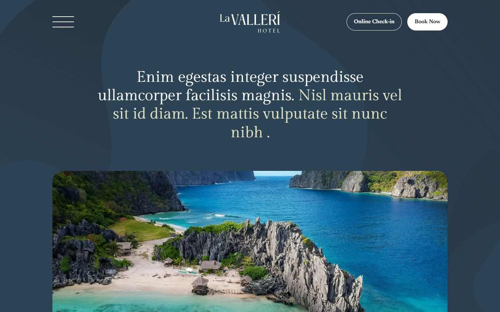
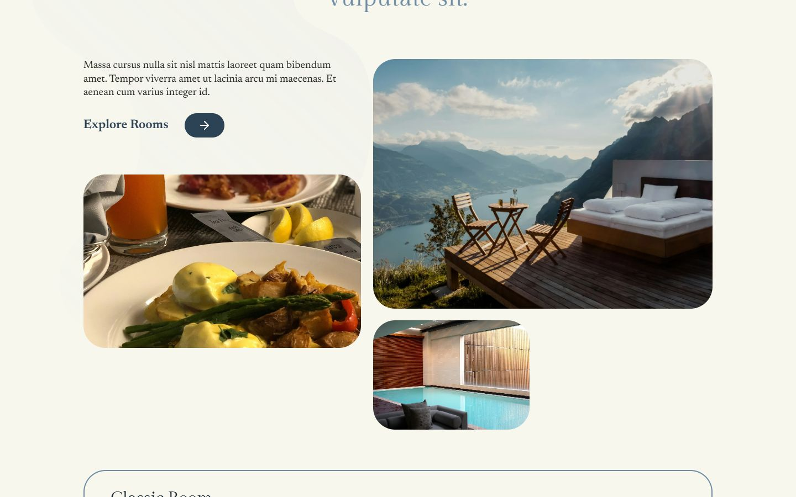
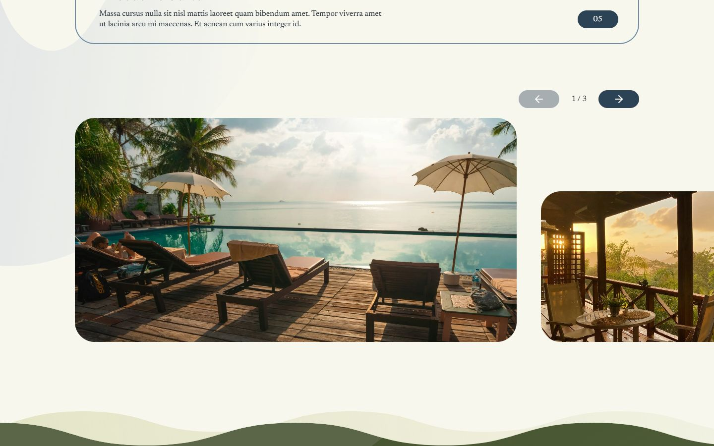
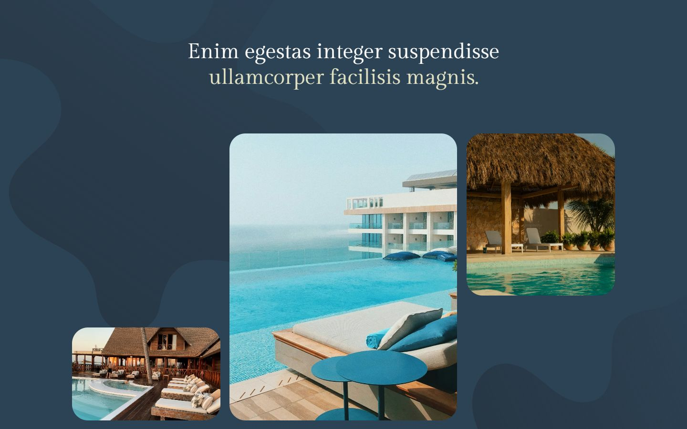

# La Valleri Hotel — Landing Page

Single-page landing for a boutique hotel, implemented from a Figma design. The focus is on pixel-accurate layout, a responsive structure and subtle motion.

**Live demo:** https://kuchinsk1y.github.io/la-hotel-landing/



<details>
<summary>More screenshots</summary>





</details>

## Features

- Sections: hero, rooms (interactive list and slider), dining, room details, discover, booking call-to-action, footer
- Responsive from 375px up; layout scales from the 1920px artboard and stops growing at 1280px
- Scroll-driven parallax on photos and background shapes, word-by-word heading reveals, smooth scrolling
- Respects `prefers-reduced-motion`
- Full-screen navigation menu with keyboard support (Esc to close, focus handling)
- Static export, deployed to GitHub Pages through GitHub Actions

## Tech stack

- [Next.js](https://nextjs.org/) (App Router) and React 19
- TypeScript
- [Tailwind CSS](https://tailwindcss.com/) v4 with design tokens defined in `globals.css`
- [Motion](https://motion.dev/) for animations and [Lenis](https://lenis.darkroom.engineering/) for smooth scrolling
- ESLint and Prettier

## Getting started

Requires Node.js 20.9 or newer.

```bash
npm install
npm run dev
```

The site is available at http://localhost:3000.

| Script              | Description                   |
| ------------------- | ----------------------------- |
| `npm run dev`       | Start the development server  |
| `npm run build`     | Create a production build     |
| `npm run lint`      | Run ESLint                    |
| `npm run typecheck` | Check types with `tsc`        |
| `npm run format`    | Format the code with Prettier |

## Project structure

```
src/
  app/                  Routes, layout, global styles and design tokens
  components/
    layout/             Header, footer, navigation menu
    motion/             Reveal, split heading, parallax image, smooth scroll
    sections/           Page sections (hero, rooms, dining, ...)
    ui/                 Shared primitives (Button, ArrowLink, Container)
  config/               Site, navigation and footer content
  data/                 Content for rooms, dining and room details
  lib/                  Helpers (class names, asset paths, easing)
  assets/               Photos imported into components
public/images/          SVG shapes and the logo
```

## Deployment

Every push to `main` runs `.github/workflows/deploy.yml`, which lints, type-checks, builds a static export with `GITHUB_PAGES=true` (this sets the `/la-hotel-landing` base path) and publishes the `out` directory to GitHub Pages.

To reproduce the Pages build locally:

```bash
GITHUB_PAGES=true npm run build
```

## Notes

- The Figma design uses licensed typefaces (TC Rooms and VC Honey). Gilda Display and Newsreader are used as free substitutes.
- Photos and copy are placeholders taken from the design file.
